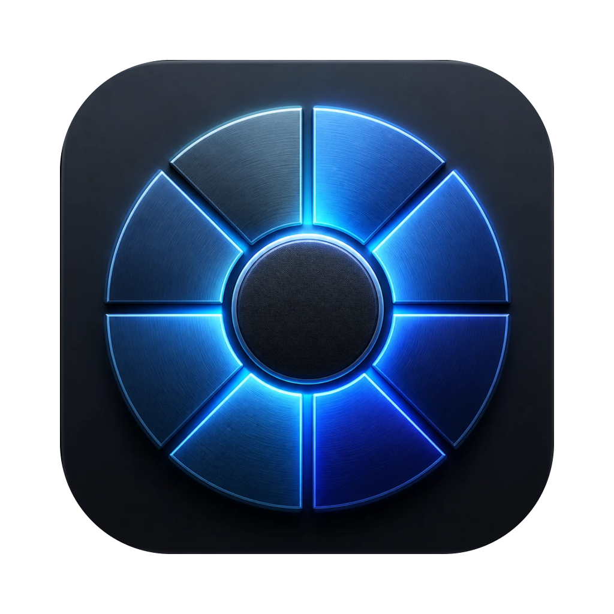
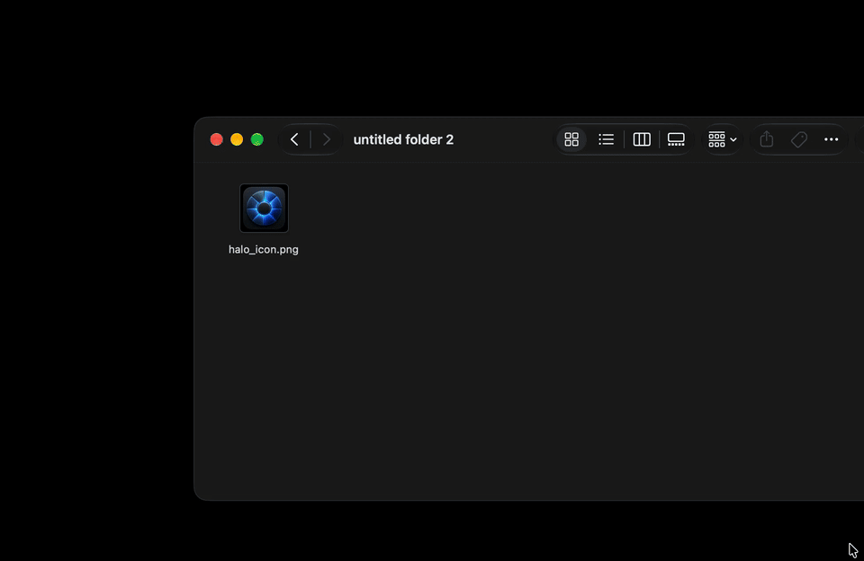

<p align="center">
  
</p>

<h1 align="center">Halo</h1>

<p align="center">Drag a file anywhere in macOS, tap a modifier, drop it on a wheel.</p>

<p align="center">
  
</p>

## How it works

1. Start dragging one or more files — from Finder, the Desktop or any app that drags files.
2. **Tap** a modifier (press and release), or **hold** it for a moment. A wheel opens under the cursor.
3. Drop the file on a segment. Drop on the center hub to cancel.

Results are saved next to the original (or in a folder you choose) and never overwrite anything — `photo.jpg` becomes `photo.webp`, `photo (compressed).jpg`, `photo 2.webp`… Click the confirmation toast to reveal the result in Finder.

| Modifier | Wheel |
| --- | --- |
| ⇧ Shift | **Conversion** — every format the dragged files can become |
| ⌘ Cmd | **Tools** — compress, edit and fix the file in place |
| ⌃ Ctrl | **Actions** — AirDrop, Float, Copy, Move, Copy Path, Terminal |

Modifiers, wheel order and the formats each wheel shows can all be changed in Settings.

## Conversion wheel

| Kind | From | To |
| --- | --- | --- |
| Images | JPG, PNG, WEBP, HEIC, TIFF, SVG, AVIF, BMP | JPG, PNG, WEBP, HEIC, TIFF, AVIF, BMP, PDF |
| Documents | PDF, DOCX, PPT, PPTX, TXT, MD, RTF, RTFD, TEXTCLIPPING | PDF, DOCX, TXT, MD, HTML, JPG, PNG |
| Spreadsheets | XLSX, XLS, ODS, CSV, TSV | XLSX, ODS, CSV, TSV, PDF |
| Audio | MP3, M4A, WAV, FLAC, OGG, OPUS, AIFF, WMA | any of the same |
| Video | MP4, MOV, MKV, WEBM, AVI, WMV, GIF | MP4, MOV, MKV, WEBM, AVI, WMV, GIF, MP3 |
| Archives | ZIP, TAR, GZIP, RAR | ZIP, TAR, GZIP |
| Subtitles | SRT, VTT | SRT, VTT, TXT |

Not every pair applies (a PDF can't become HTML, for example); **Settings → Compatibility** shows the exact matrix. Dropping several files offers only the formats all of them can reach, and batches convert three files at a time.

## Tools wheel

| Files | Tools |
| --- | --- |
| Images | Compress, Metadata, Edit, Annotate, Add BG, Crop, Resize, Redact |
| Audio | Compress, Metadata, Trim, Channels, Bleep |
| Video | Compress, Resize, Metadata, Trim, Channels, Bleep |
| PDF | Compress |

- **Edit** — exposure, brightness, contrast, highlights, shadows, saturation, vibrance, warmth; hold to compare with the original.
- **Crop** — free or fixed aspect (1:1, 4:3, 3:2, 16:9, 9:16), rule-of-thirds grid, 90° rotation.
- **Redact** — drag boxes to pixelate, blur or black out. Only Black Box is irreversible.
- **Annotate** — pen, highlighter, arrow, box and text in seven colors.
- **Add BG** — gradient, solid or custom image backdrop with padding, rounded corners, shadow and aspect ratio.
- **Metadata** — browse EXIF/GPS/TIFF data (with a location warning) and remove it all. For audio and video it strips metadata directly.
- **Trim** — drag the ends on the waveform, auto-trim silent ends, play the selection.
- **Channels** — mono or stereo with separate left/right levels and live preview.
- **Bleep** — drag across the waveform to bleep words out; preview before saving.
- **Compress / Resize** — re-encode smaller (kept only if the result is actually smaller) or scale to a preset size.

## Actions wheel

**AirDrop** the file, **Float** it on a shelf you can drag from later, **Copy** it to the clipboard, **Move** it to a folder, **Copy Path**, or open **Terminal** in its folder.

## Settings

- **General** — Glass or Solid style, launch at login, menu bar icon, sound and haptic feedback, reveal results in Finder, modifier per wheel, float behaviour, terminal app.
- **Wheels** — drag to reorder each wheel per file kind, with a live preview. The first item sits at 12 o'clock.
- **Formats** — hide conversion targets you never use.
- **Compatibility** — the full conversion matrix; dimmed ticks need an engine that isn't installed.
- **Folders** — output location and engine status.

## Requirements

- macOS 26 or later (Liquid Glass).
- **ffmpeg** for audio, video, WEBP and AVIF. Halo uses a binary embedded at build time (see below) or a Homebrew install (`brew install ffmpeg`).
- **LibreOffice** (optional) for PPT/PPTX, high-fidelity DOCX → PDF and spreadsheets (`brew install --cask libreoffice`).

Formats whose engine is missing are hidden from the wheel rather than failing. Halo is distributed outside the App Store without a sandbox, and needs no Accessibility permission.

## Build

```bash
brew install xcodegen
xcodegen generate
xcodebuild -project Halo.xcodeproj -scheme Halo build
xcodebuild -project Halo.xcodeproj -scheme Halo test
```

To ship ffmpeg inside the app, put a **statically linked** `ffmpeg` binary at `Vendor/ffmpeg` before building. Homebrew's ffmpeg is dynamically linked and can't be copied into the bundle.

In Debug builds, `open Halo.app --args -previewWheel tools` shows a wheel without a real drag.

## Architecture

| Path | Role |
| --- | --- |
| `Drag/DragMonitor` | Global mouse monitors plus modifier polling, only while a file drag is active — zero cost when idle. |
| `Wheel/` | Non-activating panel, drop hit-testing (`WheelGeometry`), SwiftUI drawing. |
| `Model/Catalog` | The conversion matrix — single source of truth for the wheel, Settings and tests. |
| `Model/WheelItem` | Wheel contents, tool lists and the user's saved order (`WheelOrder`). |
| `Engine/` | One engine per file kind (ImageIO, PDFKit, AppKit text, ffmpeg, LibreOffice, ditto/tar), plus tools and actions. |
| `Editor/` | Image and audio/video editors. Edits are previewed on a downscaled copy off the main thread, then re-applied to the full-resolution original on Apply. Audio editors play a 22 kHz preview through AVAudioEngine; exports run ffmpeg on the original. |
| `Settings/` | The Settings window. |

Tests (`HaloTests/`) cover wheel hit-testing, the format catalog, output naming, subtitles, crop/redact/rotate geometry, wheel ordering, and real ffmpeg runs of the Trim, Channels and Bleep exports.

## App icon

Designed in Canva. `scripts/make-icon.sh Vendor/icon-canva.png` finds the artwork in the Canva export, masks it onto the macOS icon grid (`Vendor/icon-master.png`) and rebuilds `Halo/Assets.xcassets/AppIcon.appiconset`.

## Known limitations

- Editors open for the first file of a multi-file drop.
- Audio/video editor previews play sound only; Bleep output is always stereo.
- Text placed in Annotate can't be moved afterwards.
- Not yet supported: PAGES and EPUB conversions, PDF → PPTX/XLSX.
